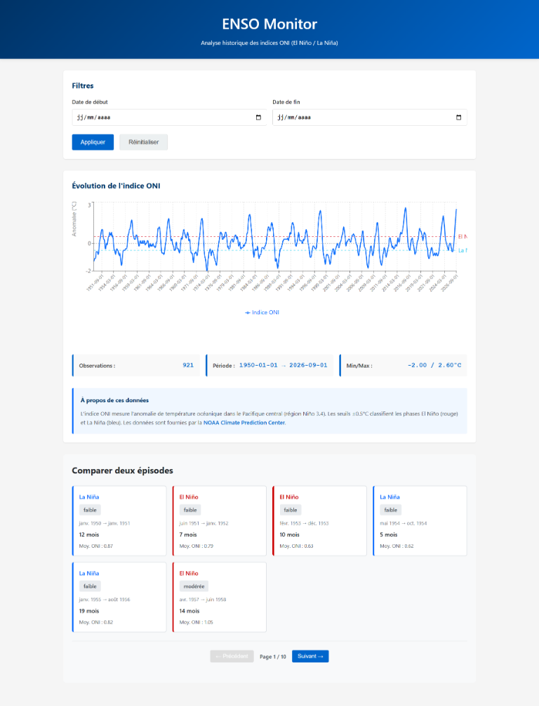

# ENSO Monitor

Application d'exploration historique des phénomènes El Niño et La Niña à partir de l'indice ONI publié par la NOAA.



## Fonctionnalités

- Visualiser l'évolution de l'indice ONI et filtrer les observations par période.
- Consulter et comparer deux épisodes identifiés dans les données.
- Importer les données NOAA dans PostgreSQL et les exposer via une API.

L'application propose une lecture historique simplifiée : les épisodes sont regroupés par seuil, sans appliquer le critère officiel de cinq saisons consécutives. Elle ne constitue pas un outil de prévision.

## Technologies

React, TypeScript et Recharts pour l'interface ; Python et FastAPI pour l'API et l'import des données ; PostgreSQL pour leur stockage. Docker Compose permet d'orchestrer les services.

## Récupérer le projet

```bash
git clone https://github.com/Oscarj-jqt/Project.git
cd Project
```

## Documentation

- [Frontend : installation, développement et tests](./enso-monitor/frontend/README.md)
- [Backend : configuration, import des données et API](./enso-monitor/backend/README.md)
- [Utilisation avec Docker Compose](./enso-monitor/DOCKER.md)
- [Source et date d'extraction des données](./enso-monitor/backend/data/README.md)
- [GitHub Project : planning et suivi des issues](https://github.com/users/Oscarj-jqt/projects/2)

