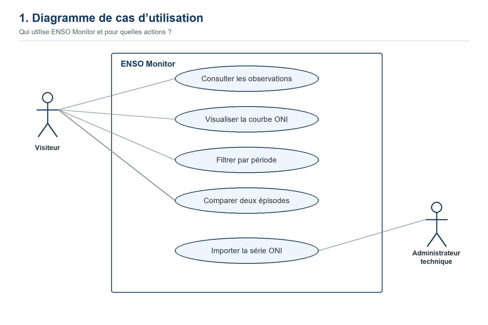
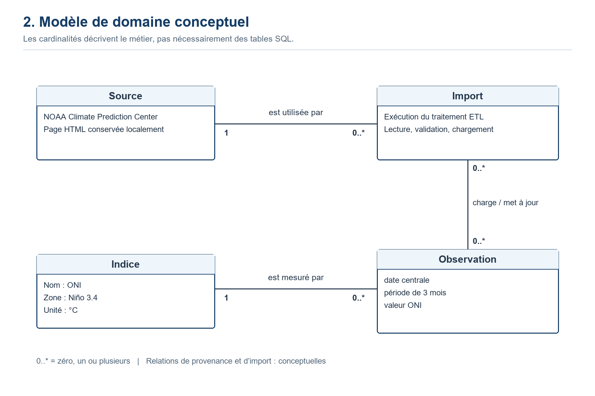
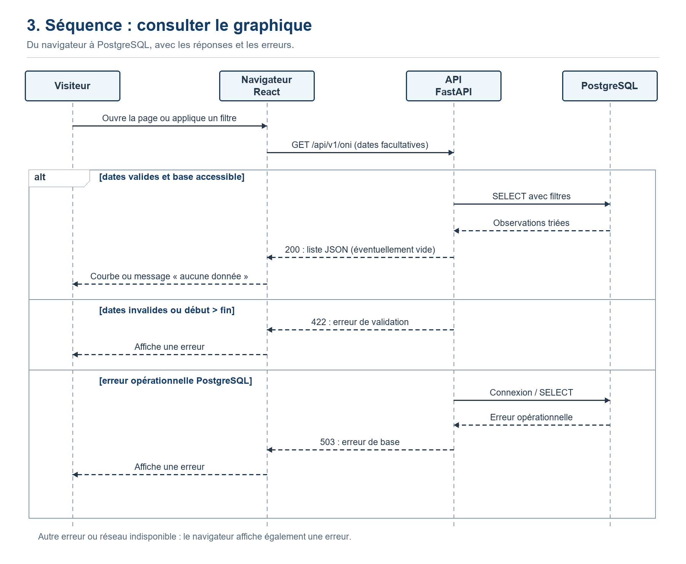

::: {.cover-gap}
:::

::: {custom-style="Title"}
ENSO Monitor
:::

::: {custom-style="Subtitle"}
**Dossier de conception**

Application d'analyse des données scientifiques  
El Niño et La Niña

Projet individuel
:::

::: {.cover-gap}
:::

::: {custom-style="Subtitle"}
**Auteur :** Oscar JACQUET

**Formation :** Bachelor Développement Web

**Année :** 2026

**Projet GitHub :** [Oscarj-jqt/Project](https://github.com/Oscarj-jqt/Project)
:::

<div style="page-break-after: always; break-after: page;"></div>

::: {custom-style="Title"}
Sommaire
:::

| Partie | Page |
|:-----------------------------------------------------------------|--------------:|
| 1. Page de couverture | 1 |
| 2. Sommaire | 2 |
| 3. Besoin et contexte | 3 |
| 4. Fonctionnel et expérience utilisateur | 4 |
| 5. UML et modélisation | 6 |
| 6. Architecture technique | 9 |
| 7. Organisation du projet | 11 |
| 8. Qualité et sécurité | 12 |
| 9. Déploiement proposé | 14 |
| 10. Bilan et sources | 15 |

<div style="page-break-after: always; break-after: page;"></div>

## 3. Besoin et contexte

### Contexte et besoin

El Niño et La Niña sont deux phases du phénomène ENSO, qui associe l'océan
et l'atmosphère dans le Pacifique équatorial. Elles correspondent notamment
à des anomalies respectivement chaudes et froides de la température de
surface. La NOAA publie ces données historiques sous forme de tableaux ;
l'objectif est de les rendre plus faciles à explorer et à comparer.

### Objectif et public

ENSO Monitor s'adresse aux personnes intéressées par le climat, y compris
sans formation scientifique. Le MVP permet d'importer une série NOAA dans
PostgreSQL, de la consulter par une API, de filtrer la courbe et de comparer
deux épisodes. L'import est une opération technique, sans compte
administrateur dans l'interface.

### Données et périmètre du MVP

L'**ONI** (*Oceanic Niño Index*) est une moyenne sur trois mois des anomalies
de température de surface dans la région Niño 3.4, en °C. Les périodes se
chevauchent : DJF correspond à décembre, janvier et février. L'ONI a été
retenu pour sa série historique documentée et son interprétation directe.
Le **RONI**, utilisé par la NOAA pour le suivi officiel, ajuste aussi
l'anomalie Niño 3.4 par rapport à la moyenne tropicale : les deux indices ne
sont pas interchangeables.

Le projet est réalisé individuellement sur cinq jours, avec un périmètre
volontairement sobre.

### Limites d'interprétation

La copie NOAA date du 18 novembre 2026 et n'est pas actualisée
automatiquement ; les valeurs récentes peuvent être révisées. L'outil ne
prévoit pas le climat ni les effets locaux. La NOAA colore les périodes
historiques atteignant ±0,5 °C pendant au moins cinq saisons mobiles
consécutives ; l'application regroupe les valeurs par seuil **sans ce
minimum**. Ses épisodes sont donc exploratoires, non officiels.

<div style="page-break-after: always; break-after: page;"></div>

## 4. Fonctionnel et expérience utilisateur

### User stories et priorisation

Les quatre user stories du GitHub Project décrivent les besoins principaux
du produit. Elles constituent le **périmètre prioritaire du MVP** : sans
import fiable, consultation, filtrage et comparaison, l'application ne
répondrait pas à son objectif d'exploration.

| User story | Besoin et critère d'acceptation |
|---|---|
| **US1 — Importer** | L'administrateur technique importe la série NOAA dans PostgreSQL. Un nouvel import met à jour une date existante sans créer de doublon. |
| **US2 — Consulter** | L'utilisateur accède aux observations par l'API. Une requête valide renvoie une liste structurée et triée par date. |
| **US3 — Filtrer** | L'utilisateur sélectionne une période. Les observations et la courbe correspondent aux bornes demandées ; une période vide est signalée. |
| **US4 — Comparer** | L'utilisateur sélectionne deux épisodes différents. Leurs caractéristiques sont affichées côte à côte, à partir des données filtrées. |

### Critères d'acceptation complémentaires

- Une observation comporte une date centrale, une période et une valeur ONI.
- Une date invalide ou un début postérieur à la fin est rejeté par l'API
  avec le code **422**.
- La réinitialisation des filtres permet de revenir à la série complète.
- La comparaison est descriptive : les épisodes affichés ne constituent pas
  nécessairement des épisodes officiels au sens de la NOAA (voir partie 3).

Ces critères sont des résultats attendus, non une preuve de validation. Les
exports, statistiques avancées et écran d'administration sont hors MVP.

<div style="page-break-after: always; break-after: page;"></div>

### Parcours utilisateur et gestion des états

1. **Consulter :** le visiteur ouvre l'application. Les données sont
   demandées à l'API, puis la courbe présente l'évolution de l'ONI et ses
   repères en degrés Celsius.
2. **Explorer :** il peut saisir une ou deux dates, appliquer le filtre,
   puis le réinitialiser pour retrouver la série complète.
3. **Comparer :** il sélectionne deux cartes d'épisodes parmi ceux de la
   période affichée et consulte les caractéristiques présentées côte à côte.

Pendant la demande, un message de chargement apparaît. Une requête échouée
affiche un message d'erreur ; une période sans observation affiche
« Aucune donnée pour cette période ». L'import suit un parcours séparé :
l'administrateur technique exécute l'ETL, sans écran d'administration.

### Wireframe

La maquette initiale organise l'écran autour de la période, de la courbe,
de la comparaison et des explications :

```text
ENSO Monitor — Source NOAA, indice ONI

Période : [ date de début ]   [ date de fin ]

                  Courbe ONI

Comparer deux épisodes : [ épisode A ]  [ épisode B ]

Explication des résultats, source et limites
```

Cette maquette est un schéma d'intention, pas une capture de l'application.
Dans l'interface réalisée, les épisodes sont sélectionnés sous forme de
cartes plutôt qu'au moyen des deux champs représentés ci-dessus. Les cartes
sont également sélectionnables au clavier avec Entrée ou Espace. La
lisibilité sur mobile et l'accessibilité du graphique restent à vérifier
dans la section consacrée à la qualité.

<div style="page-break-after: always; break-after: page;"></div>

## 5. UML et modélisation

### Diagramme de cas d'utilisation

{width=100%}

Le **visiteur** consulte la courbe, filtre les observations et compare deux
épisodes. L'**administrateur technique** lance l'import de la série ONI ;
ce rôle ne correspond pas à un compte connecté. Le rectangle délimite le
système, les ellipses ses fonctionnalités et les traits les actions
accessibles à chaque acteur.

<div style="page-break-after: always; break-after: page;"></div>

### Modèle de domaine conceptuel

{width=100%}

Une observation associe une date, une période et une valeur à un indice ;
un indice peut regrouper plusieurs observations. Un import utilise une
source et peut charger plusieurs observations ; une même observation peut
être mise à jour lors de plusieurs imports. `1` signifie exactement un et
`0..*` zéro à plusieurs.

Ce modèle est **conceptuel** : les observations sont stockées dans la table
`oni`, mais les sources, indices et imports ne disposent pas de tables ni
de relations persistées. L'historique individuel des imports n'est donc pas
conservé en base.

<div style="page-break-after: always; break-after: page;"></div>

### Diagramme de séquence : consultation du graphique

{width=100%}

À l'ouverture ou après un filtre, le navigateur demande les observations à
l'API, qui interroge PostgreSQL et renvoie une liste JSON. Le navigateur
affiche la courbe ou signale l'absence de données. Le cadre **alt** présente
les autres chemins : une période invalide produit une réponse **422** ; une
erreur opérationnelle PostgreSQL traitée par l'API produit une **503**.
Une erreur réseau est également signalée dans l'interface.

<div style="page-break-after: always; break-after: page;"></div>

## 6. Architecture technique

### Composants et flux de données

```text
CONSULTATION
Serveur frontend -> Navigateur : interface React / TypeScript
Navigateur -> API FastAPI -> PostgreSQL : lecture des observations
Navigateur <- API FastAPI <- PostgreSQL : réponse et données

IMPORT
NOAA -> copie HTML locale -> ETL Python -> PostgreSQL : table oni
```

Le **frontend** regroupe les filtres, le graphique Recharts et la comparaison
des épisodes. Il transmet les dates choisies à l'API et affiche la réponse.
La comparaison est calculée dans le navigateur à partir des observations
reçues.

L'**API FastAPI** fournit `GET /api/v1/oni` et accepte les paramètres
facultatifs `debut` et `fin`. Elle valide les dates, interroge PostgreSQL
avec des paramètres SQL et renvoie les observations par ordre chronologique.
La route `GET /health` vérifie l'accès à la base. Un pool de connexions
synchrone permet de réutiliser les connexions.

L'**ETL Python** est distinct du parcours de consultation : il lit la copie
HTML NOAA présente dans le projet, extrait les observations, contrôle les
valeurs et les charge dans PostgreSQL. L'import utilise une transaction et
met à jour une date déjà présente au lieu de créer un doublon. La commande
`python -m etl.load` permet de le lancer manuellement depuis le backend.
Un mécanisme d'initialisation au démarrage existe également ; il ne constitue
pas un service worker indépendant. Si la table est vide et que le fichier
HTML manque, ce mécanisme ignore actuellement l'import sans message d'erreur :
cette limite rend le diagnostic d'une base vide moins évident.

La copie locale documente la provenance et la date d'extraction. Elle ne
garantit pas une mise à jour automatique ni un historique des imports.

<div style="page-break-after: always; break-after: page;"></div>

### Modèle SQL et persistance

La table `oni` comporte trois champs utilisés par l'ETL et l'API :

| Champ | Rôle |
|---|---|
| `date_centrale` | Date du mois central ; unique pour éviter les doublons. |
| `periode` | Code de la période de trois mois, par exemple `DJF`. |
| `valeur_oni` | Valeur de l'anomalie ONI en °C. |

Deux migrations coexistent : celle du backend utilise la date comme clé
primaire, `NUMERIC` et des contraintes de période ; celle montée par Compose
utilise un `id`, une date unique, `FLOAT` et `created_at`, sans les mêmes
contraintes. Le schéma dépend donc de l'initialisation et ces migrations
doivent être unifiées. Les scripts ne sont pas rejoués sur un volume existant.

### Choix techniques et compromis

- **React et TypeScript** structurent et typent l'interface, au prix d'un
  build ; l'accessibilité de la courbe reste à vérifier.
- **FastAPI** valide les entrées et documente les routes versionnées ; il
  ajoute un service mais évite l'accès direct du navigateur à PostgreSQL.
- **PostgreSQL**, plutôt qu'un fichier ou SQLite, permet contraintes et
  filtres, mais demande davantage de configuration ; des requêtes et tests
  vérifient l'unicité et les filtres.
- **ETL séparé** : l'import et ses contrôles sont indépendants de la
  consultation, mais doivent être exécutés ; un nouvel import vérifie
  l'absence de doublons.
- **Pool synchrone** : il simplifie les tests du MVP, au prix d'une capacité
  de concurrence potentiellement inférieure à une solution asynchrone.

Compose décrit le frontend, le backend et la base ; l'exécution locale des
deux premiers reste possible. Le déploiement cible figure en partie 9.

<div style="page-break-after: always; break-after: page;"></div>

## 7. Organisation du projet

### Backlog et planning

Le projet est réalisé individuellement sur cinq jours. Le [GitHub Project](https://github.com/users/Oscarj-jqt/projects/2)
assure le suivi du backlog ; un journal conserve le déroulement et les
difficultés rencontrées.

| Jour | Objectif principal |
|---|---|
| **J1 — Cadrage** | Sources, choix ONI, MVP, user stories et maquette. |
| **J2 — Données** | Extraction, contrôles et import dans PostgreSQL. |
| **J3 — API** | Routes FastAPI, filtres et tests. |
| **J4 — Interface** | Courbe, comparaison, tests frontend et conteneurisation. |
| **J5 — Finalisation** | Vérifications, dossier, démonstration et oral. |

{width=100%}

*Figure — Suivi à l'étape J5 : trois issues en cours, dont le dossier et le
README, et 27 issues terminés au moment de la capture.*

Les tâches **P0** couvrent les fonctionnalités et tests indispensables ;
la maquette est prévue en **P1**. L'export est écarté du MVP. Git et GitHub
assurent le versionnement et le suivi ; VS Code, Docker, les tests et les
README accompagnent la réalisation.

**Risques et arbitrages :** limiter les extensions ; utiliser un pool
synchrone après les difficultés de tests sous Windows ; sauvegarder la base
avant toute suppression de volume. Les migrations et les limites
scientifiques de la comparaison restent à vérifier.

<div style="page-break-after: always; break-after: page;"></div>

## 8. Qualité et sécurité

### Stratégie de tests

La stratégie couvre les données, l'API et les traitements frontend. Elle
privilégie des exemples simples et des résultats vérifiables :

| Niveau | Vérifications principales |
|---|---|
| **ETL — Pytest** | Transformation d'une ligne, cellules vides, valeur non numérique et valeurs de référence de la copie NOAA. |
| **API — Pytest** | Structure et tri des observations, filtres de dates, période vide et erreur 422 pour des dates invalides. Ces tests nécessitent PostgreSQL et des données chargées. |
| **Frontend — Vitest** | Extraction et comparaison d'épisodes, exemples de filtrage et présence des méthodes du client API. |

Lors d'une exécution locale précédente, **5 tests ETL et 10 tests API** ont
réussi. Le fichier `frontend/TESTS.md` rapporte **16 tests frontend réussis** ;
ce résultat n'a pas été relancé pour cette rédaction.

Les tests frontend ont une limite : les exemples de filtrage ne rendent pas
le composant React, et les tests du client API vérifient surtout l'existence
de ses méthodes. Ils ne prouvent donc pas à eux seuls qu'un changement de
dates actualise réellement le graphique. Un test de composant ou de bout en
bout reste nécessaire pour couvrir ce parcours.

**Commandes de vérification** :

```powershell
# Depuis backend/ ; PostgreSQL démarré et données chargées pour les tests API
python -m pytest tests/test_oni_etl.py tests/test_oni_api.py -q

# Depuis frontend/
npm test -- --run
```

### Vérifications UX

La démonstration a montré une courbe alimentée par les observations
importées. Avant la livraison, il reste à vérifier sur ordinateur et mobile
le filtrage, la réinitialisation, la comparaison, les états de chargement et
d'erreur, ainsi que la lisibilité des axes et de la légende. La navigation
au clavier et les contrastes doivent également être contrôlés : la présence
de contrôles clavier dans le code ne suffit pas à attester une conformité
complète en matière d'accessibilité.
 
<div style="page-break-after: always; break-after: page;"></div>

### Sécurité et performances

- **Données et requêtes :** l'API valide les dates et utilise des requêtes
  SQL paramétrées. Il n'existe pas d'interface d'administration ni de
  mécanisme d'authentification pour le visiteur.
- **Configuration :** les fichiers `.env` sont exclus par `.gitignore` et
  le mot de passe est fourni par l'environnement. Les secrets ne doivent
  pas être intégrés au dépôt ; aucune analyse complète de l'historique Git
  ou audit de sécurité n'est revendiqué ici.
- **Accès :** PostgreSQL est publié sur `127.0.0.1` dans Compose. CORS
  autorise les origines configurées pour l'interface ; il ne remplace ni
  l'authentification ni la protection d'un déploiement public.
- **Performance :** le filtrage est effectué en base et le backend utilise
  un pool de connexions. Aucun test de charge ni objectif chiffré de temps
  de réponse n'a été validé ; il faudra mesurer les temps de réponse et le
  rendu sur la série complète avant d'affirmer que l'application passe à
  l'échelle.

### Anomalies et améliorations à suivre

La suppression d'un volume PostgreSQL lors du dépannage a effacé les données ;
elles ont été rechargées par l'ETL. Les points suivants restent à traiter
ou à vérifier avant la livraison :

1. **Schéma :** unifier les deux migrations de la table `oni`, qui n'imposent
   pas les mêmes contraintes.
2. **Comparaison :** la valeur présentée comme moyenne ONI est actuellement
   calculée à partir des valeurs absolues ; une moyenne négative de La Niña
   peut donc apparaître positive. La durée correspond à l'écart entre les
   dates, et une seule observation donne zéro mois. Clarifier les métriques
   et ajouter des tests de résultats chiffrés.
3. **Validation finale :** compléter le test réel du parcours graphique,
   les contrôles UX et la vérification des performances et de sécurité.

<div style="page-break-after: always; break-after: page;"></div>

## 9. Déploiement proposé

Cette architecture est une **cible de déploiement**, non un déploiement
réalisé ou validé. Elle adapte le Compose actuel en ajoutant Caddy et en
limitant les ports exposés.

### Architecture cible

```text
Navigateur -- HTTPS --> VPS : Caddy (ports 80 et 443)
                           |-- /api/*, /health --> API FastAPI
                           |-- autres chemins --> Frontend React
                                                   (fichiers statiques)
API FastAPI -- réseau interne --> PostgreSQL -- volume postgres_data
ETL Python  -- import ---------------------------------> PostgreSQL
```

Caddy termine la connexion HTTPS et redirige les requêtes vers les services
internes. Un réseau relie Caddy au frontend et à l'API ; un second relie
l'API à PostgreSQL. Seuls les ports 80 et 443 de Caddy sont publiés : ni
l'API ni PostgreSQL ne sont directement exposés sur Internet. Des volumes
persistants conservent les données PostgreSQL et les certificats de Caddy.

### Procédure envisagée

1. Préparer un VPS avec Docker Compose, un nom de domaine pointant vers son
   adresse et un pare-feu autorisant 80/443 ; protéger l'accès SSH.
2. Créer une configuration Compose de production et un `Caddyfile` :
   router `/api/*` et `/health` vers le backend, sans modifier les chemins,
   et les autres requêtes vers le frontend. Caddy pourra obtenir des
   certificats HTTPS si le domaine et les ports sont accessibles.
3. Configurer les secrets hors du dépôt et construire le frontend avec une
   URL d'API relative au même domaine : le navigateur ne peut pas résoudre
   le nom interne Docker `backend`. Unifier la migration SQL, démarrer les
   services, puis importer les données ONI si la base est vide.
4. Vérifier le certificat, les journaux, `/health`, la récupération des
   observations et l'affichage du graphique depuis le navigateur.

**Sauvegardes et limites :** planifier des sauvegardes PostgreSQL avec
`pg_dump`, les conserver chiffrées hors du VPS et tester leur restauration
sur une base isolée. Le volume seul n'est pas une sauvegarde. La configuration
Caddy, les réseaux de production, la restauration et la supervision restent
à mettre en place et à tester avant une mise en ligne.

<div style="page-break-after: always; break-after: page;"></div>

## 10. Bilan et sources

### Bilan du projet

ENSO Monitor transforme une série historique ONI de la NOAA en observations
consultables, filtrables et visualisées sous forme de courbe. Le choix de
l'ONI répond au besoin d'exploration historique ; il ne remplace pas le
suivi officiel actuel fondé sur le RONI. L'ETL, PostgreSQL, l'API FastAPI
et l'interface React séparent les étapes d'import, de stockage et de
consultation. Ce découpage facilite la compréhension, mais demande de
configurer plusieurs composants.

Le projet a notamment rencontré des difficultés de tests asynchrones et de
chargement des données dans Docker. Le passage à un pool synchrone a
simplifié les tests. Après la perte des données du volume PostgreSQL lors
du dépannage, la correction du chemin et de la configuration de l'ETL a
permis de recharger la série. Ces incidents ont montré l'importance de
vérifier les hypothèses, de préserver les volumes et de contrôler le
résultat après chaque intervention.

Le MVP permet une exploration descriptive, mais les limites scientifiques,
les métriques de comparaison et les migrations restent à prendre en compte
comme indiqué aux parties 3, 6 et 8. Le déploiement sur VPS présenté en
partie 9 reste une proposition.

### Utilisation de l'intelligence artificielle

GitHub Copilot dans VS Code a été utilisé en complément de mes idées initiales
pour organiser la conception et le planning, accompagner le développement de
la base, du backend et du frontend, aider au dépannage et contribuer aux
tests, diagrammes et à la documentation. Ses propositions ont servi d'aide,
pas de garantie de justesse : certains diagnostics et interventions étaient
incorrects. Les choix, les résultats et les limites doivent donc être
compris et vérifiés à partir du code, des sources et des tests.

### Sources scientifiques

- NOAA Climate Prediction Center, [Oceanic Niño Index — ONI, version ERSSTv6](https://www.cpc.ncep.noaa.gov/products/analysis_monitoring/enso/oni/v6/index.php).
- NOAA Climate Prediction Center, [Relative Oceanic Niño Index — RONI](https://www.cpc.ncep.noaa.gov/products/analysis_monitoring/enso/roni/).
- Article d'actualité consulté :
(https://www.slate.fr/monde/phenomene-el-nino-affaiblissement-premature-vortex-polaire-froid-meteo)
- Articles explicatifs
(https://www.noaa.gov/understanding-el-nino)
(https://oceantoday.noaa.gov/elninolanina/)


